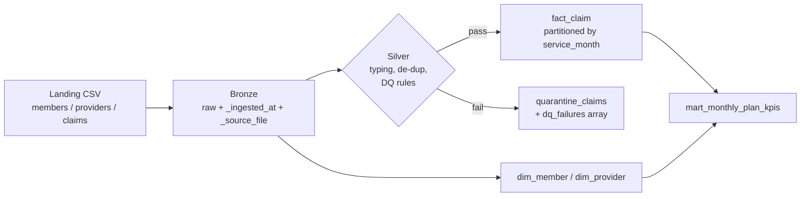

# Healthcare Claims Lakehouse (PySpark, Medallion Architecture)

> **Representative portfolio project.** Independently written with 100% synthetic data. It is not code from, and does not describe the internal systems of, any employer or client.

A bronze → silver → gold pipeline for healthcare claims, members, and providers. It shows the patterns I use on Azure Databricks: raw ingest with lineage columns, typed and de-duplicated silver tables, rule-based data quality with a quarantine table, and a star-schema gold layer with a monthly KPI mart.

## Business problem

Payers receive claims from many sources with duplicates, bad amounts, and members that do not exist yet. Reporting teams need trustworthy claim counts, paid totals, denial rates, and claim lag by plan and month, and auditors need to see which records were rejected and why.

## Architecture



| Layer | What happens | Output |
|---|---|---|
| Bronze | Read as strings; add `_ingested_at`, `_source_file` | in-memory DataFrames |
| Silver | Cast types, de-duplicate on `claim_id` (latest ingest wins), apply 5 DQ rules | valid claims + `quarantine_claims` |
| Gold | Star schema and KPI mart | `fact_claim`, `dim_member`, `dim_provider`, `mart_monthly_plan_kpis` |

Data quality rules (`src/claims_lakehouse/pipeline.py`): `billed_non_negative`, `paid_le_billed`, `received_after_service`, `member_exists`, `status_valid`. A row can fail several rules; all failures are recorded.

## Tech stack

Python 3.10+, PySpark 3.5, Parquet locally / Delta Lake on Databricks, pytest, ruff, GitHub Actions, Docker.

## Run it

```bash
pip install -e ".[dev]"          # needs Java 17 for local Spark
python -m claims_lakehouse --generate --config conf/local.yaml
pytest -q
```

Or with Docker: `docker build -t claims-lakehouse . && docker run --rm claims-lakehouse`

### On Azure Databricks

Point `landing_path` / `output_path` at ADLS Gen2 (`abfss://...`) and set `table_format: delta`. Use a Databricks secret scope or Unity Catalog external location for storage access; never put keys in the config file.

## Sample output

Run report from a local run with the default config (`docs/sample_run_report.json`):

```json
{"bronze_claims": 2032, "silver_claims": 1960, "quarantined": 40,
 "dq_failures": {"billed_non_negative": 18, "paid_le_billed": 18, "member_exists": 22}}
```

The 32-row difference between bronze and silver+quarantine is duplicate claim IDs collapsed during de-duplication.

`mart_monthly_plan_kpis` (first rows, see `docs/sample_output.txt`):

| service_month | plan_code | claims | paid_total | denial_rate | avg_days_to_receive |
|---|---|---|---|---|---|
| 2024-01 | MARKETPLACE | 47 | 68014.42 | 0.1277 | 20.21 |
| 2024-01 | MEDICAID | 56 | 78476.90 | 0.0536 | 22.95 |
| 2024-01 | MEDICARE_ADV | 68 | 90420.76 | 0.1176 | 25.93 |

## Tests

`tests/test_pipeline.py` covers deterministic data generation, each quarantine rule on hand-built rows, and an end-to-end run that checks row accounting and KPI bounds.

## Security and compliance notes

- All data is generated by `synthetic.py`; there is no PHI or PII in this repository.
- Paths and settings come from config; credentials belong in a secret store (Databricks secret scopes, Azure Key Vault).
- In a real HIPAA environment you would add column-level masking, Unity Catalog grants, and audit logging; those are out of scope here.

## Limitations and next steps

- Full refresh only; next step is incremental MERGE into Delta tables with Auto Loader.
- Rules are code-defined; could be moved to config or Great Expectations suites.
- No orchestration included; a Databricks Workflow or Airflow DAG would schedule it.

## License

MIT
